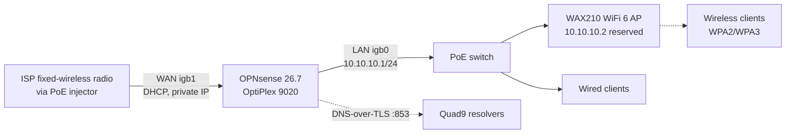

# OPNsense Home Firewall: DNS Security, IDS & Hardening Build

Replacing an ISP-managed mesh router with a self-built **OPNsense** firewall on recycled enterprise hardware. The build adds a business-grade **WiFi 6 access point**, **network-wide DNS filtering and enforcement**, **encrypted upstream DNS**, **hardened SSH administration**, and a **Suricata intrusion detection system**.

> **Status:** Phases 1 and 2 complete (core network, DNS filtering and enforcement, SSH hardening, IDS). Phase 3 (VLAN segmentation, IPS tuning, Wazuh SIEM integration) planned. See the [Roadmap](#roadmap).

---

## Table of Contents
- [Why I Built This](#why-i-built-this)
- [Hardware](#hardware)
- [Network Topology](#network-topology)
- [Phase 1: Core Build](#phase-1-core-build)
- [Phase 2: DNS Security](#phase-2-dns-security)
- [Phase 2: SSH Hardening](#phase-2-ssh-hardening)
- [Phase 2: Intrusion Detection (Suricata)](#phase-2-intrusion-detection-suricata)
- [Troubleshooting Case Studies](#troubleshooting-case-studies)
- [Results](#results)
- [Security Decisions](#security-decisions)
- [Skills Demonstrated](#skills-demonstrated)
- [Lessons Learned](#lessons-learned)
- [Roadmap](#roadmap)

---

## Why I Built This

- **Remove ISP-controlled equipment.** The ISP-supplied mesh router could be managed remotely by the provider, and I had no visibility into what it was doing on my network.
- **Own the security boundary.** I wanted a firewall where I control the rules, logs, updates, and DNS.
- **Hands-on skills.** Building, breaking, troubleshooting, and documenting real infrastructure is part of my preparation for an entry-level cybersecurity role and the CompTIA Security+ exam.

---

## Hardware

| Role | Device | Notes |
|---|---|---|
| Firewall / router | Dell OptiPlex 9020 (SFF) | ~8 GB RAM, BIOS A25, OPNsense 26.7 |
| Storage | Samsung SSD 840 EVO 120 GB | ZFS install |
| WAN / LAN NIC | Intel I350 dual-port gigabit (PCIe) | `igb` driver, well supported on FreeBSD |
| Spare NIC | Onboard Intel I217-LM | Reserved for a future lab/management network |
| Wireless | NETGEAR WAX210 (AX1800 WiFi 6, PoE) | Local management only, no vendor cloud |
| Switching | Gigabit PoE switch | Powers the access point |
| Upstream | Rural fixed-wireless ISP | Rooftop radio + PoE injector |

**Why an Intel NIC?** OPNsense runs on FreeBSD, where Intel NICs are far more reliable than Realtek.

---

## Network Topology



| Interface | Device | Addressing |
|---|---|---|
| WAN | `igb1` (I350) | DHCP from ISP radio (private address, so upstream is double NAT) |
| LAN | `igb0` (I350) | `10.10.10.1/24` |
| Spare | `em0` (onboard I217) | Unassigned, planned for lab/management |

**Addressing plan:** `.1` is the firewall, `.2` to `.99` are reserved for infrastructure (static DHCP reservations), and `.100` and up is the dynamic client pool. The LAN was moved off the default `192.168.1.0/24` to avoid conflicts during testing and cutover.

---

## Phase 1: Core Build

### Hardware prep and firmware
- Confirmed the BIOS was already on the latest release (**A25**, which includes the INTEL-SA-00233 fix). Verified **UEFI** boot and that both I350 ports were detected.
- Put WAN and LAN on the **add-in I350**, not the onboard NIC, partly because Intel ME/AMT is bound to the onboard port.

### Installation
- Downloaded the OPNsense amd64 VGA image and **verified its SHA-256 checksum** before writing it to USB.
- Installed to the SSD with **ZFS**, which is resilient to power loss and supports **boot-environment snapshots** for rolling back a bad update.

### Initial configuration
- Assigned WAN/LAN by matching NIC MAC addresses to physical ports, then labeled the ports.
- LAN `10.10.10.1/24`, DHCP enabled, web GUI on HTTPS only.
- Setup wizard:
  - `home.arpa` domain (RFC 8375)
  - Quad9 upstream DNS, with ISP DNS override disabled
  - Unbound resolver with **DNSSEC**
  - WAN **RFC1918 and bogon blocking**
  - Automatic DHCP-to-DNS hostname registration, so logs show device names
- Tested everything **offline** from a laptop on the LAN before touching the production network.

### Cutover
- Moved the ISP radio's PoE-injector uplink from the old router to the firewall's WAN, then power-cycled the radio. WAN pulled a lease on the first try, and the ISP router was retired.

### Wireless access point
- Configured the WAX210 in **local/standalone mode** and did **not** enroll it in the vendor's cloud management.
- Firmware **1.1.0.31 → 1.1.0.36** (1.1.0.34 and later include vendor security fixes). Updated manually, because the AP's automatic check had run before it had internet access.
- One SSID on 2.4 and 5 GHz, **WPA2/WPA3-Personal**, with a new strong passphrase (the factory one is printed on the label).
- **Disabled the factory "CONFIG-ONLY" management SSID**, which still used the label password.
- Static DHCP reservation at `10.10.10.2`.

### DNS filtering (Unbound blocklists)

| List | Purpose |
|---|---|
| HaGeZi Multi **PRO** | Ads, trackers, telemetry, general malware |
| HaGeZi **Threat Intelligence Feeds** | Malware, phishing, C2 domains |
| HaGeZi **Fake** | Scam shops and fraudulent sites |

About **1.6 million domains** loaded. Blocked lookups are answered as `0.0.0.0`. I deliberately picked a few complementary lists instead of "select all" to limit false positives and memory use.

---

## Phase 2: DNS Security

DNS filtering only works if clients actually use it. Smart TVs, IoT devices, and some apps hardcode public resolvers, and modern OSes and browsers can tunnel DNS inside TLS or HTTPS. Phase 2 closes those gaps.

### 1. Force all LAN DNS through the firewall (NAT redirect)
**Firewall → NAT → Destination NAT**

| Field | Value |
|---|---|
| Interface | LAN |
| Protocol | TCP/UDP |
| Source | LAN net |
| Destination | **NOT** This Firewall (inverted), port 53 |
| Redirect target | `127.0.0.1:53` (Unbound) |
| Log | Enabled, to collect evidence of bypass attempts |

**Verification:** asking Google's resolver directly for a blocklisted domain:
```powershell
nslookup ad-g.doubleclick.net 8.8.8.8
```
- **Before:** returned a real Google IP, because the query went straight to `8.8.8.8` and bypassed filtering.
- **After:** returned `0.0.0.0`. The query was silently intercepted, sent to Unbound, and filtered.

### 2. Block outbound DNS-over-TLS (TCP/UDP 853)
**Firewall → Rules → LAN:** block, source LAN net, destination any, port `domain-s` (853), logging enabled, IPv4+IPv6.

**Verification:**
```powershell
Test-NetConnection 1.1.1.1 -Port 853
```
```
PingSucceeded    : True
TcpTestSucceeded : False
```
The host can still reach `1.1.1.1`. **Only** encrypted DNS is blocked, which shows the control is targeted and doesn't break general connectivity. (This rule needed a rule-order fix; see the [case study](#case-study-2-the-block-rule-that-didnt-block).)

### 3. Encrypt the firewall's own upstream DNS (DNS-over-TLS to Quad9)
**Services → Unbound DNS → DNS over TLS**

| Server | Port | Verify CN |
|---|---|---|
| `9.9.9.9` | 853 | `dns.quad9.net` |
| `149.112.112.112` | 853 | `dns.quad9.net` |

The ISP can no longer see or log the household's DNS lookups, and the **CN verification** protects against a spoofed resolver. The LAN DoT block doesn't affect this, because it only applies to traffic *from* LAN clients, not from the firewall itself.

### Result: layered DNS control
| Bypass technique | Control |
|---|---|
| Hardcoded resolver (e.g. `8.8.8.8:53`) | NAT redirect to Unbound |
| DNS-over-TLS (`:853`) | Firewall block |
| Browser DNS-over-HTTPS | Disabled in browsers; DoH-provider blocklist planned |
| ISP snooping on upstream DNS | DNS-over-TLS to Quad9 |

---

## Phase 2: SSH Hardening

**Starting point:** SSH enabled on LAN only, with root login and password authentication allowed.

**End state:** key-only authentication with a named, non-root admin account.

1. **Generated an ed25519 key pair** on my admin workstation, protected with a passphrase:
   ```powershell
   ssh-keygen -t ed25519
   ```
2. **Created a named admin account** in OPNsense (*System → Access → Users*): member of `admins`, shell `/bin/sh`, public key in *Authorized keys*.
3. **Enabled sudo** for the admin group (*System → Settings → Administration → Sudo*). See the [sudo case study](#case-study-3-not-in-the-sudoers-file).
4. **Verified the new path worked** (key login and `sudo pfctl -sr`) **before** removing the old one.
5. **Disabled root login and password authentication** for SSH.

**Verification:**
```
$ ssh root@10.10.10.1
root@10.10.10.1: Permission denied (publickey).

$ ssh <admin>@10.10.10.1
Enter passphrase for key '.../id_ed25519':
<admin>@OPNsense:~ $
```

The `(publickey)` in the denial shows the server no longer even offers password authentication, so brute-force password guessing is off the table. Admin actions now go through a **named account plus sudo**, which provides accountability. Access is **LAN-only**, needs **something you have** (the private key), and needs **something you know** (the key passphrase).

> **Recovery path:** the physical console still accepts the root password. It's documented, and the root password is stored offline.

---

## Phase 2: Intrusion Detection (Suricata)

### Configuration
**Services → Intrusion Detection**

| Setting | Value | Why |
|---|---|---|
| Mode | **PCAP live (IDS, alert only)** | Establish a baseline and find false positives before enabling blocking (IPS) |
| Interface | **LAN** | Alerts show the *internal* device involved; on WAN, NAT would hide every source behind the firewall's address |
| Rulesets | ET Open: malware, exploit, scan, phishing, coinminer, attack_response; abuse.ch | Focused categories instead of "everything", to keep noise manageable |
| Rule updates | Scheduled via cron | Signatures stay current without manual work |

### Validation
The usual test page, `testmynids.org`, has **expired**: it now returns a parked "domain for sale" page instead of the `uid=0(root)` payload, so no alert fired (see [case study 4](#case-study-4-the-ids-test-that-tested-nothing)). I validated with a **known-bad User-Agent** instead:

```powershell
curl.exe -A "Mozilla/5.0 (compatible; Nmap Scripting Engine; https://nmap.org/book/nse.html)" http://example.com
```

**Alert raised:**

| Field | Value |
|---|---|
| Alert | **ET SCAN Possible Nmap User-Agent Observed** |
| SID | 2024364 |
| Protocol | TCP |
| Source | `10.10.10.212:52587` (my laptop) |
| Destination | `104.20.23.154:80` (`example.com`) |
| Interface | LAN |
| HTTP user-agent | `Mozilla/5.0 (compatible; Nmap Scripting Engine; ...)` |

**Limitation to note:** the test had to use plain `http://`. A network IDS can't see inside TLS-encrypted traffic, so HTTPS payloads are invisible to signature matching without TLS interception. Metadata like DNS, SNI, and JA3/JA4 fingerprints, plus DNS filtering, partly covers that gap.

---

## Troubleshooting Case Studies

### Case study 1: "The blocklist isn't blocking"
**Symptom:** `doubleclick.net` and `ad.doubleclick.net` still resolved after the blocklists were enabled.

**Process (OPNsense shell):**
1. `sockstat -4l -p 53` showed only **Unbound** bound to port 53, so there was no resolver conflict with Dnsmasq.
2. `configctl unbound dnsbl` and `ls -lh /var/unbound/data/` showed `dnsbl.json` present at about 159 MB, so the lists had downloaded.
3. `grep module-config /var/unbound/unbound.conf` showed `"python validator iterator"`, and the Unbound log showed `blocklist loaded. length is 1599943`.
4. Inspecting the JSON showed exact-domain keys with `wildcard: true`, and `grep -c '"ad.doubleclick.net"'` returned **0**. HaGeZi deliberately leaves out some Google ad domains to avoid breaking Shopping and search links.
5. `drill ad-g.doubleclick.net @127.0.0.1` (a domain that **is** listed) returned `0.0.0.0`.

**Root cause:** the blocking worked the whole time. My test domain wasn't on the list.

### Case study 2: The block rule that didn't block
**Symptom:** after creating the LAN rule blocking port 853, `Test-NetConnection 1.1.1.1 -Port 853` still succeeded.

**Process:** the GUI suggested the rule had been moved to the top, so I checked the ruleset pf had **actually loaded**:
```sh
pfctl -sr | grep -n -E "853|domain-s|igb0:network"
```
**Before:**
```
89: pass in quick on igb0 inet from (igb0:network) to any ...
...
92: block drop in log quick on igb0 inet proto tcp from (igb0:network) to any port = domain-s
```
The `quick` **pass** rule matched first, so the block rule was never evaluated. pf uses first-match semantics for `quick` rules.

**Fix:** re-ordered the rules (selecting only the block rule before using the GUI's move action) and re-applied.

**After:**
```
89: block drop in log quick on igb0 inet proto tcp from (igb0:network) to any port = domain-s
...
95: pass in quick on igb0 inet from (igb0:network) to any ...
```
**Lesson:** check the **running** ruleset, not just the GUI. Rule order is one of the most common firewall misconfigurations.

### Case study 3: "Not in the sudoers file"
**Symptom:** the new admin account could log in with its key, but `sudo` returned `<admin> is not in the sudoers file`.

**Cause:** sudo was enabled, but restricted to the `wheel` group, and the account was in `admins`.

**Fix:** set the sudoers group to `wheel, admins` and re-tested. Root login was only disabled after this worked, so I was never locked out.

### Case study 4: The IDS test that tested nothing
**Symptom:** no Suricata alert after the standard `testmynids.org` test.

**Process:** I read the HTTP response instead of assuming the IDS was broken. The domain had expired, and the parked page contained no malicious-looking content. I switched to a signature that matches on the request itself (the Nmap User-Agent), which alerted right away.

**Lesson:** validate the **test case** before blaming the tool. This was the second time in this project a bad test nearly sent me in the wrong direction (see case study 1).

---

## Results

| Test | Result |
|---|---|
| Wired throughput through OPNsense | ~120 Mbps (ISP plan limit) |
| Wi-Fi throughput (WiFi 6) | ~108 Mbps (~90% of wired) |
| DNS blocklist | ~1.6M domains, confirmed `0.0.0.0` responses |
| Hardcoded-DNS bypass (`8.8.8.8`) | Intercepted, filtered (`0.0.0.0`) |
| DNS-over-TLS bypass (`:853`) | Blocked (`TcpTestSucceeded : False`) |
| Upstream DNS | Encrypted to Quad9 (DoT, CN-verified) |
| SSH as root | `Permission denied (publickey)` |
| SSH as admin | Key + passphrase login, sudo working |
| IDS | ET SCAN alert (SID 2024364) raised and attributed to the source host |

---

## Security Decisions

| Decision | Rationale |
|---|---|
| Management (GUI/SSH) on **LAN only** | No management exposure on WAN |
| SSH **key-only**, **no root**, named admin + sudo | Removes password brute force; accountability; least privilege |
| AP in **local** management mode | No vendor-cloud dependency or remote management path |
| Factory SSIDs and passwords replaced or disabled | Label credentials are effectively public |
| WAN on add-in NIC | Keeps Intel AMT's NIC off the internet-facing side |
| RFC1918 + bogon blocking, anti-spoofing, default deny | Drops spoofed or unroutable traffic; implicit deny |
| DNS NAT redirect + DoT block | Enforces the DNS security control instead of trusting clients |
| DNSSEC + DoT to Quad9 | Integrity and confidentiality of DNS |
| Suricata in **IDS** mode first | Learn the baseline and tune false positives before blocking |
| Encrypted config backups, ZFS snapshots | Recoverability; stored secrets protected |
| Checksum-verified installer | Integrity of the OS image |

---

## Skills Demonstrated

- **Network design:** addressing plans, interface roles, DHCP reservations
- **Firewall engineering:** NAT redirection, rule ordering, `pf` ruleset verification
- **DNS security:** recursive resolution, DNSSEC, DoT, threat-intel blocklists, bypass prevention
- **Intrusion detection:** Suricata deployment, ruleset selection, alert validation and analysis
- **System hardening:** SSH key auth, least privilege, sudo, credential hygiene
- **Wireless security:** WPA2/WPA3, removing default management interfaces
- **Patch and vulnerability management:** OS, BIOS, AP firmware, IDS signatures
- **CLI troubleshooting:** `pfctl`, `sockstat`, `drill`, `configctl`, `nslookup`, `Test-NetConnection`, `curl`, log analysis
- **Change management:** offline testing, staged cutover, verify-before-removing access, backups
- **Technical documentation**

**CompTIA Security+ concepts applied:** defense in depth, implicit deny, rule order, anti-spoofing, IDS vs. IPS, signature-based detection, secure protocols (HTTPS, SSH, DNSSEC, DoT), least privilege, accountability, hardening, patch management, threat intelligence.

---

## Lessons Learned

1. **Verify the test before blaming the system.** Two of my four troubleshooting cases came down to a bad test case: a domain that wasn't on the list, and an expired test site.
2. **Trust the running state, not the GUI.** `pfctl -sr` showed the truth about rule order when the GUI was misleading.
3. **Never remove the old access path until the new one is proven.** Sudo was verified before root SSH was disabled.
4. **Controls need enforcement.** A DNS filter that clients can bypass is a suggestion, not a control.
5. **Encryption cuts both ways.** DoT protects my DNS from the ISP, and the same kind of encryption blinds the IDS to HTTPS payloads.

---

## Evidence / Screenshots

> Screenshots are in [`/screenshots`](./screenshots). MAC addresses, serial numbers, and credentials are redacted.

| File | Shows |
|---|---|
| `interfaces-overview.png` | WAN/LAN up, addressing |
| `dnsbl-policy.png` | Blocklist policy configuration |
| `drill-blocked.png` | `0.0.0.0` response for a blocklisted domain |
| `nat-redirect-test.png` | `nslookup ... 8.8.8.8` returning `0.0.0.0` |
| `pfctl-rule-order-before.png` / `-after.png` | Rule-order fix |
| `dot-block-test.png` | `Test-NetConnection` ping OK / TCP 853 blocked |
| `ssh-root-denied.png` | Root denied, key-based admin login |
| `suricata-alert.png` | ET SCAN Nmap User-Agent alert details |
| `speedtests.png` | Wired vs. Wi-Fi throughput |

---

## Roadmap

- [x] Core firewall, Wi-Fi, DNS filtering
- [x] DNS enforcement (NAT redirect, DoT block)
- [x] Encrypted upstream DNS (DoT to Quad9)
- [x] SSH hardening (keys, non-root admin, sudo)
- [x] Suricata IDS with ET Open rules
- [ ] **Wazuh SIEM integration:** forward Suricata EVE, firewall, and DNS logs to my [Purple Team Wazuh lab](https://github.com/jkuck22/purple-team-wazuh-lab) for correlation and alerting
- [ ] **VLAN segmentation:** trusted / IoT / guest / lab, mapped to AP SSIDs
- [ ] **Move Suricata to IPS mode** after a week of baseline tuning
- [ ] DoH-provider blocking
- [ ] TOTP two-factor authentication for the web GUI
- [ ] Disable Intel AMT in MEBx
- [ ] Automated off-box config backups

---

*Sensitive details (passwords, keys, serial numbers, MAC addresses, public IPs, and ISP/location specifics) are intentionally left out of this write-up.*
